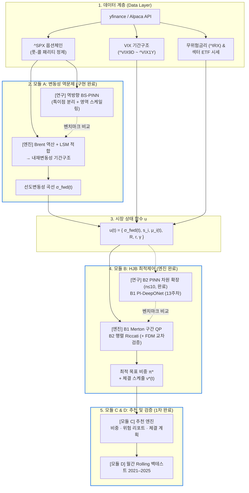
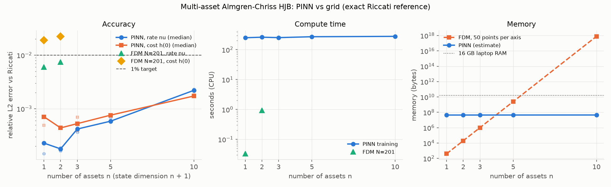

# mfin — 블랙-숄즈 · HJB 기반 포트폴리오 추천 시스템

[](https://www.python.org/)
[](https://pytorch.org/)
[](#-진행-현황-및-로드맵)
[](#-관련-문서)

> **2026-2 수학탐구 프로젝트**  
> 금융수학(블랙-숄즈 PDE, Merton HJB 최적제어)과 인공지능(PINN)을 결합한 S&P 500 동적 자산배분 시스템  
> 
> - **관련 문서**: [구현방안.md](구현방안.md) (전체 설계 상세) · [설계대안.md](설계대안.md) (설계 대안 및 채택 근거)

---

## 📌 목차
1. [프로젝트 개요](#-프로젝트-개요)
2. [전체 시스템 아키텍처](#-전체-시스템-아키텍처)
3. [진행 현황 및 로드맵](#-진행-현황-및-로드맵)
4. [설치 및 개발 환경](#-설치-및-개발-환경)
5. [폴더 및 파일 구조](#-폴더-및-파일-구조)
6. [실행 가이드](#-실행-가이드)
   - [테스트 실행](#1-테스트-실행)
   - [모듈 A 실험 (표·그래프 생성)](#2-모듈-a-실험-표그래프-생성)
   - [옵션 데이터 수집 및 자동화](#3-옵션-데이터-수집-및-자동화)
   - [백테스트 (모듈 D)](#4-백테스트-모듈-d)
   - [오늘 기준 추천 (모듈 C)](#5-오늘-기준-추천-모듈-c)
   - [모듈 B 실험 (엔진, PINN 연구)](#6-모듈-b-실험)
   - [결과 확인 앱 (Streamlit)](#7-결과-확인-앱-streamlit)
7. [모듈 A 핵심 수학적 설계 (보고서 요약)](#-모듈-a-핵심-수학적-설계-보고서-요약)
8. [모듈 B·C 핵심 설계 (보고서 요약)](#-모듈-bc-핵심-설계-보고서-요약)
9. [알려진 제약 및 엔지니어링 고려사항](#-알려진-제약-및-엔지니어링-고려사항)

---

## 💡 프로젝트 개요

`mfin`은 시장의 파생상품 가격으로부터 내재된 위험(변동성 기간구조)을 역산하고, 이를 거시적 제약 조건 하에서 **HJB(Hamilton-Jacobi-Bellman) 확률제어 방정식**을 통해 최적의 포트폴리오 비중으로 변환하는 엔드투엔드 퀀트 자산배분 시스템입니다.

### 2-Track 설계 철학
- **운용 엔진 (Production Engine)**: 검증된 수치해석/해석해(Brent 역산, FDM, 볼록 최적화 QP)로 안정적인 추천을 도출합니다.
- **연구 비교 모듈 (Research Modules)**: 물리 정보 신경망(**PINN**) 및 연산자 학습(**DeepONet**)을 같은 문제에 적용하여 정확도, 속도, 고차원 확장성을 정량 비교합니다.

---

## 🏗 전체 시스템 아키텍처



---

## 📈 진행 현황 및 로드맵

| 단계 | 모듈 | 내용 | 상태 | 비고 |
| :--- | :--- | :--- | :---: | :--- |
| **Step 1** | **데이터 계층** | 옵션체인 정제, VIX 기간구조, 캐시 시스템, 옵션체인 스냅샷 자동 수집(GitHub Actions) | ✅ 완료 | 자동 수집은 첫 장중 실행으로 확인 예정 |
| **Step 1** | **모듈 A (변동성)** | 블랙-숄즈 역문제 (해석해 적합 vs 역방향 PINN) | ✅ 완료 | 특이점 분리(Bachelier) 적용 |
| **Step 2** | **모듈 B 엔진** | Merton 해석해·제약 QP, 다자산 Almgren–Chriss Riccati, n=1·2 FDM 교차검증 | ✅ 완료 | 2026-11-15 |
| **Step 2** | **모듈 B 연구 (B2)** | 다자산 Almgren–Chriss PINN 차원 확장(n=1→10), 기준해 ablation | ✅ 완료 | 2026-11-19, n=10까지 오차 0.25% 미만 |
| **Step 2** | **모듈 B 연구 (B1)** | Merton PI-DeepONet | ⏳ 13주차 | `solver="neural"` 자리 마련됨 |
| **Step 3** | **모듈 C (추천 엔진)** | 상태 추정, 목표 비중, 위험 리포트, 체결 스케줄 | ✅ 1차 완료 | 실시간 CLI 포함 |
| **Step 3** | **결과 확인 앱** | Streamlit 3탭: 오늘의 추천, 추천 근거, 백테스트 비교 | ✅ 1차 완료 | `python -m mfin.app` |
| **Step 4** | **모듈 D (백테스트)** | 2021–2025 월간 rolling 백테스트, 5개 전략 비교 | ✅ 1차 완료 | ablation·AUM·AC 비용 차감은 14주차 |
| **Step 4** | **모듈 D (모의운용)** | Alpaca Paper 연동 | ⏳ 15주차 | |

---

## 💻 설치 및 개발 환경

프로젝트 루트의 가상환경(`.venv`)이 기본 제공됩니다. 새로운 환경을 구성할 경우 아래 단계에 따라 설치합니다.

> [!NOTE]
> PyTorch는 CPU 전용 빌드로 설치하여 패키지 용량과 종속성 충돌을 최소화했습니다.

```powershell
# 1. 가상환경 생성
python -m venv .venv

# 2. PyTorch (CPU 전용) 설치
.\.venv\Scripts\python.exe -m pip install torch --index-url https://download.pytorch.org/whl/cpu

# 3. 개발용 의존성 및 mfin 패키지 editable 설치
.\.venv\Scripts\python.exe -m pip install -e ".[dev]"

# 4. (선택) 결과 확인 앱용 Streamlit
.\.venv\Scripts\python.exe -m pip install -e ".[app]"
```

*이후 모든 Python 명령은 가상환경 인터프리터(`.\.venv\Scripts\python.exe`, 이하 `python`)로 실행합니다.*

---

## 📁 폴더 및 파일 구조

```
project/
├── src/mfin/                     # 핵심 소스코드 패키지
│   ├── data/                     # [데이터 계층] 시세 수집, 전처리, 캐싱
│   │   ├── cache.py              #   - parquet 로컬 캐시 및 지수 백오프 재시도
│   │   ├── loaders.py            #   - 주가, 무위험금리(^IRX → 연속복리 r) 로더
│   │   ├── vix_term.py           #   - VIX 기간구조 수집 (9일, 30일, 3개월, 6개월, 1년)
│   │   ├── option_chain.py       #   - SPX 체인 수집, 풋-콜 패리티(F, D 추정), OTM 환산
│   │   └── snapshot_collector.py #   - 일일 옵션체인 스냅샷 수집 (장중·신선도 판정 후 저장)
│   ├── engine/                   # [운용 엔진] 전통적 금융수학 수치 알고리즘
│   │   ├── bs_analytic.py        #   - Black-76 / 블랙-숄즈 해석해 및 Greeks 계산
│   │   ├── implied_vol.py        #   - Brent 역산 내재변동성, 상수 σ 최소제곱 적합
│   │   ├── vol_term.py           #   - ATM 변동성 기간구조, 국소 선도변동성 곡선 σ_fwd(t)
│   │   ├── merton.py             #   - B1: Merton 계수, 정확한 제약 QP(NNLS), 구간 정책, 가치함수
│   │   ├── riccati_ac.py         #   - B2: 다자산 Almgren–Chriss 행렬 Riccati (ODE + 닫힌 해)
│   │   └── fdm_hjb.py            #   - B2: n=1·2 Godunov 풍상 FDM (Riccati 교차검증)
│   ├── portfolio/                # [모듈 C] 추천 엔진
│   │   ├── estimators.py         #   - Ledoit–Wolf 상관, EWMA 배율, 기대수익 모형, VIX/옵션 선도분산
│   │   ├── risk.py               #   - 변동성, VaR/CVaR, 위험기여도, 보호적 풋 비용
│   │   ├── execution.py          #   - 주문 수량, 충격 행렬 Λ, 체결 스케줄
│   │   └── engine.py             #   - recommend() (solver 선택), 실시간 상태, CLI
│   ├── backtest/                 # [모듈 D] Rolling-window 백테스트
│   │   ├── strategies.py         #   - SPY B&H, 1/N, Markowitz, Merton(EWMA), 제안 모델(VIX)
│   │   ├── rolling.py            #   - 설정 로딩, 데이터 정렬, 시뮬레이션 루프, 결과 저장
│   │   └── metrics.py            #   - CAGR, Sharpe, Sortino, MDD, Calmar, 회전율, 비용 손실
│   ├── app/                      # [결과 확인 앱] Streamlit (python -m mfin.app)
│   │   ├── main.py               #   - 화면: 오늘의 추천 / 추천 근거 / 백테스트 비교
│   │   ├── data.py               #   - 추천·백테스트 결과를 표와 그림용 데이터로 변환, 해석 문장
│   │   └── charts.py             #   - Altair 그림 (라이트·다크 팔레트)
│   ├── pinn/                     # [연구 모듈] 물리 정보 신경망 (PINN)
│   │   ├── core.py               #   - MLP 아키텍처, Autograd 미분, Adam → L-BFGS 최적화
│   │   ├── bs_inverse.py         #   - 블랙-숄즈 역방향 PINN (특이점 분리 기법 탑재)
│   │   └── ac_multi.py           #   - B2: 다자산 Almgren–Chriss HJB PINN (차원 확장 실험)
│   └── experiments/              # [실험 및 시각화]
│       ├── module_a.py           #   - 합성/실데이터 벤치마크 실험 및 표/그래프 생성
│       ├── module_a_robustness.py #  - 잡음·smile에 대한 PINN 편향 진단 및 손실 가중치 실험
│       └── module_b.py           #   - Riccati 차원 확장, FDM 수렴, Merton γ 비교, PINN 차원 확장
├── .github/workflows/snapshot.yml # 옵션체인 스냅샷 예약 수집 (GitHub Actions → data-snapshots 브랜치)
├── configs/main.toml             # 백테스트 설정 (유니버스, 기간, γ, 비용, 체결)
├── .streamlit/config.toml        # 앱 설정 (localhost 전용, 사용 통계 끔)
├── tests/                        # 단위 및 통합 테스트 (pytest)
├── data_cache/                   # 다운로드 캐시 및 일일 스냅샷 (gitignore 대상)
├── results/                      # 실험 결과 표(.tex, .csv) 및 차트(.png)
├── 구현방안.md                   # 전체 아키텍처 및 구현 세부 계획서
└── 설계대안.md                   # 방법론 비교 및 의사결정 근거 보고서
```

---

## 🚀 실행 가이드

### 1. 테스트 실행
Pytest 마커(`slow`, `network`)를 통해 필요한 범위의 테스트를 선택 실행합니다.

```powershell
# 1) 빠른 단위 테스트 (기본 권장, 약 3초)
python -m pytest

# 2) PINN 신경망 학습 검증 (합성 데이터 대상, CPU 기준 약 3분)
python -m pytest -m slow

# 3) 실시간 금융 API 연동 스모크 테스트 (네트워크 필요)
python -m pytest -m network
```

---

### 2. 모듈 A 실험 (표·그래프 생성)
실험 스크립트를 실행하면 `results/module_a/` 디렉터리에 비교 표와 시각화 차트가 자동으로 생성됩니다.

```powershell
# [실험 1] 합성 데이터 (Ground Truth 대비 PINN vs 엔진 정확도 비교, 약 15분)
python -m mfin.experiments.module_a --synthetic

# [실험 2] S&P 500 실시장 데이터 (약 10~15분)
python -m mfin.experiments.module_a --live

# [빠른 확인용] 실데이터 학습 epoch 축소 버전 (약 5분)
python -m mfin.experiments.module_a --live --fast
```

---

### 3. 옵션 데이터 수집 및 자동화
yfinance는 과거 옵션체인을 주지 않으므로, 매 거래일 **미국 장중**에 SPX 옵션체인 전체를 스냅샷으로 저장해 둡니다. 놓친 날은 나중에 받을 수 없습니다.

#### 자동 수집: GitHub Actions (기본, PC가 꺼져 있어도 동작)
[.github/workflows/snapshot.yml](.github/workflows/snapshot.yml)이 평일 두 번 실행되어, 결과를 이 저장소의 **`data-snapshots` 브랜치** `snapshots/` 폴더에 커밋합니다(하루 약 300KB).

| 실행 (UTC) | 겨울 (EST) | 서머타임 (EDT) | 비고 |
| :--- | :--- | :--- | :--- |
| 16:23 | 11:23 ET | 12:23 ET | 반일장(13:00 마감)에도 장중 |
| 19:13 | 14:13 ET | 15:13 ET | 오늘 장이 열렸는데 오늘 파일이 없으면 실패 처리 → GitHub 실패 메일 |

- 수집기는 저장 전에 **ATM 근방 호가 비율 ≥ 80%** 와 **시세가 45분 이내**인지 확인합니다. 휴장일·장 마감 후 실행은 저장하지 않고 건너뜁니다(실행 요약에 경고). 같은 날 두 번 받으면 더 늦은 스냅샷이 남습니다.
- 수동 실행: GitHub 저장소의 **Actions → option-chain-snapshot → Run workflow**. 장중에 한 번 돌려 로그의 호가 비율과 Yahoo 차단(HTTP 429) 여부를 확인하세요.
- 예약 실행은 기본 브랜치(main)에 워크플로 파일이 있어야 동작하며, GitHub 사정으로 10–60분 늦어지거나 드물게 빠질 수 있습니다.

로컬로 가져오기 (`data_cache/snapshots/`에 풀림, 같은 이름 파일은 덮어씀):
```powershell
git fetch origin data-snapshots
git archive -o data_cache\snapshots.tar origin/data-snapshots snapshots
tar -xf data_cache\snapshots.tar -C data_cache; Remove-Item data_cache\snapshots.tar
```

#### 1회 수동 수집 (로컬)
```powershell
python -m mfin.data.snapshot_collector                 # 결과: data_cache/snapshots/SPX_YYYYMMDD.parquet
python -m mfin.data.snapshot_collector --force         # 판정과 무관하게 저장 (장외 시험용)
```

> [!IMPORTANT]
> 반드시 **장중**에 수집해야 합니다. 장이 끝나면 호가가 갱신되지 않고(주말에는 지워져 마지막 체결가만 남음), 종목마다 시각이 다른 가격이 섞여 내재변동성이 왜곡됩니다.

#### 대안: Windows 작업 스케줄러 (Yahoo가 GitHub 서버를 막을 때)
PC가 켜져 있고 로그인된 상태에서만 동작합니다. 장중이면 어느 시각이든 되므로, PC가 주로 켜져 있는 시간(겨울 한국 시간 23:30–06:00 사이)을 고르면 됩니다. 아래는 한국 시간 00:30(겨울 10:30 ET), 화~토요일 예시입니다.
```powershell
schtasks /Create /TN "mfin_spx_snapshot" /SC WEEKLY /D TUE,WED,THU,FRI,SAT /ST 00:30 /TR "\"C:\Users\wlsgu\Documents\3학년 2학기\수학탐구\project\.venv\Scripts\python.exe\" -m mfin.data.snapshot_collector"
schtasks /Delete /TN "mfin_spx_snapshot" /F    # 삭제
```

---

### 4. 백테스트 (모듈 D)
설정 파일 하나로 2021–2025 월간 rolling 백테스트를 돌리고 `results/backtest/main/`에 표와 그림을 만듭니다(첫 실행은 2005년부터의 데이터를 내려받습니다).

```powershell
python -m mfin.backtest.rolling --config configs/main.toml
# 일부 전략만
python -m mfin.backtest.rolling --config configs/main.toml --strategies equal_weight,proposed
```

2026-11-15 실행 결과는 아래와 같습니다. 조건은 γ=5, 비용 5bp, $1M입니다.

| 전략 | CAGR | 연변동성 | Sharpe | MDD | 연 회전율 |
|---|---:|---:|---:|---:|---:|
| spy_buyhold | 14.7% | 17.1% | 0.70 | −24.5% | 0.20 |
| equal_weight | 16.2% | 15.0% | 0.86 | −15.1% | 0.57 |
| markowitz | 16.7% | 19.8% | 0.71 | −24.0% | 5.55 |
| merton_hist (EWMA 변동성) | 12.8% | 10.1% | 0.92 | −10.3% | 2.65 |
| proposed (VIX 선도변동성) | 7.7% | 6.7% | 0.65 | −5.9% | 2.17 |

- proposed는 평균 63%를 현금으로 들고 갑니다. merton_hist는 44%입니다.
- 원인은 VIX에 분산위험프리미엄이 들어 있다는 점입니다. 1개월 선도변동성이 평균 19.4%로, 실현변동성 기반 EWMA의 16.1%보다 높습니다.
- 두 전략은 기대수익 모형이 같고 변동성 입력만 다르므로, 이 차이가 곧 변동성 입력의 효과입니다(ablation).

### 5. 오늘 기준 추천 (모듈 C)
```powershell
python -m mfin.portfolio.engine --gamma 5 --aum 1e6               # SPX 옵션체인 -> VIX -> EWMA 순으로 변동성 결정
python -m mfin.portfolio.engine --gamma 5 --aum 1e6 --put-hedge   # 보호적 풋 비용 포함
```
출력은 목표 비중(현금 포함)과 무제약 Merton 비중, 위험 리포트(변동성, 1일 VaR/CVaR, SPX skew), 30분 단위 체결 스케줄입니다.

### 6. 모듈 B 실험
```powershell
# 엔진: Riccati 차원 확장, FDM 수렴, Merton γ 비교 (1분 이내)
python -m mfin.experiments.module_b --riccati --fdm --merton
# 결과: results/module_b/ (riccati_scaling.csv, fdm_convergence.csv/png, merton_gamma.csv, riccati_trajectories.png)

# [연구] B2 PINN 차원 확장: n = 1, 2, 3, 5, 10 × seed 3개 (CPU 약 70분)
python -m mfin.experiments.module_b --pinn
python -m mfin.experiments.module_b --pinn --fast --seeds 1          # 반복 수를 줄인 빠른 확인 (약 3분)
python -m mfin.experiments.module_b --pinn --gate linear --seeds 1   # 기준해 없는 형태 ablation (약 25분)
# 결과: pinn_scaling.csv/png, pinn_trajectory.png, pinn_history.csv (ablation은 _linear 접미사)
```

**B2 PINN 결과** (2026-11-19, Riccati 닫힌 해 대비 상대 L2 오차, seed 3개 중앙값. 통과 기준은 ν·h(0) 모두 1% 미만)

| 자산 수 n | PINN ν 오차 | PINN h(0) 오차 | 학습 시간 | 기준해 없는 PINN ν / h(0) (seed 0) | FDM N=201 ν / h(0) (계산 시간) | 격자 메모리 (축당 50점, 시간 단면 1개) |
| :---: | ---: | ---: | ---: | ---: | ---: | ---: |
| 1 | 0.023% | 0.071% | 251 s | 0.12% / 0.10% | 0.60% / 1.91% (0.03 s) | 400 B |
| 2 | 0.018% | 0.044% | 261 s | 0.39% / 0.41% | 0.74% / 2.24% (0.9 s) | 20 KB |
| 3 | 0.042% | 0.053% | 253 s | 0.99% / 0.73% | — | 1 MB |
| 5 | 0.059% | 0.076% | 271 s | **1.20%** / 0.77% | — | 2.5 GB |
| 10 | 0.22% | 0.17% | 278 s | **5.37%** / 3.46% | — | 7.8 × 10¹⁷ B |

- ν는 최적 매매 속도, h(0)는 t=0의 최소 집행비용입니다. 시험점은 시간 단면 t ∈ {0, 0.25, 0.5, 0.75, 0.9}에서 상자 안 균일점 2000개와 정답 궤적 위의 점입니다.
- **기준해 + 보정** 형태는 n=10까지 seed 3개 모두 통과했습니다. 학습 시간(4–5분)과 메모리(약 45 MB)가 n에 거의 무관합니다.
- 기준해를 빼면 ν 오차가 5–24배 커지고 n=5부터 기준을 넘습니다. 만기 직전 경계층을 기준해가 흡수한다는 설계 의도가 확인됩니다.
- PINN 정책으로 실제 집행한 궤적의 오차는 n=10에서 0.2%, 초과 비용은 0.001% 수준입니다.
- 낮은 차원에서는 엔진이 압도적입니다. FDM은 수백–수천 배 빠르고, Richardson 외삽(101, 201)을 하면 h(0) 오차가 0.019%/0.014%로 PINN보다 작습니다. 그래서 **서비스 경로는 엔진을 유지**합니다. PINN의 강점은 격자 없이 n=10에서도 같은 비용으로 1% 미만을 낸다는 점입니다.
- FDM의 궤적 오차(n=1에서 20%, CSV `traj_err`)는 1차 풍상 스킴의 성질입니다. 원점 근처 기울기에 격자 간격 수준의 치우침이 남아, 크기가 격자 1–2칸인 작은 주문에서 상대오차가 커집니다(N=201: q=0.01에서 정책 오차 82%, q=0.2에서 4%).



### 7. 결과 확인 앱 (Streamlit)
추천 결과와 그 근거, 백테스트 결과를 브라우저에서 봅니다. 처음 한 번 `pip install -e ".[app]"`이 필요합니다.
```powershell
python -m mfin.app                          # http://localhost:8501 이 열립니다 (종료: Ctrl+C)
python -m mfin.app --server.port 8502       # 다른 포트
```

| 탭 | 내용 |
| :--- | :--- |
| **오늘의 추천** | 해석 문장(현금이 남는 이유, 0%인 자산의 이유 등), 주식·현금 비중, 기대 초과수익, 변동성, 사전 Sharpe, 1일 VaR/CVaR, β, 목표 비중·위험기여도 그림과 표 |
| **추천 근거** | ① 기대수익 분해(무위험 r + CAPM β·ERP + 모멘텀 view) ② 내재변동성 기간구조 vs SPY 실현변동성 ③ Ledoit–Wolf 상관행렬 ④ 무제약 Merton 해 vs 롱온리 해, KKT 검증 |
| **백테스트 비교** | 성과표, 누적 수익(로그축)·낙폭, 전략별 월별 비중, 제안 모델 vs Merton(과거 변동성)의 현금 비중·σ_fwd 비교 |

- 사이드바의 γ, 보유기간, 변동성 출처(옵션체인/VIX), 보호적 풋 설정을 바꾸면 앞의 두 탭이 바로 다시 계산됩니다(QP 1ms 미만).
- 시장 데이터는 앱 안에서 1시간 캐시합니다. 앞의 두 탭은 네트워크가 필요하고, 백테스트 탭은 `results/backtest/` 아래 저장된 결과만 읽습니다. 백테스트를 다시 돌리면 새 결과를 자동으로 읽습니다.
- 주문 수량과 체결 스케줄은 앱에 없으며 CLI(5절)로 봅니다.

---

## 🔬 모듈 A 핵심 수학적 설계 (보고서 요약)

본 프로젝트는 전통적인 캘리브레이션 방식(Brent 역산)과 현대 딥러닝 기반 역문제 해결(Inverse PINN)을 유기적으로 비교·연계하도록 정밀하게 설계되었습니다.

### 1. 무차원 좌표 변환 (Dimensionless PDE)
블랙-숄즈 방정식을 선도가격 $F$와 행사가격 $K$에 대해 무차원화하여 금리 $r$와 배당수익률 $q$를 선도가격 $F$에 완전히 흡수시킵니다.
- **좌표 정의**: $x = \frac{F}{K}$, $\quad v(\tau, x) = \frac{e^{r\tau} V(\tau, K)}{K}$
- **단순화된 PDE**:
  $$v_\tau = \frac{1}{2} \sigma^2 x^2 v_{xx}$$
- **시장 데이터 전처리**: 각 만기별로 풋-콜 패리티(Put-Call Parity) 회귀분석 $C - P = D(F - K)$을 수행하여 할인계수 $D = e^{-r\tau}$와 무편향 선도가격 $F$를 시장 데이터로부터 직접 추정합니다.

---

### 2. 특이점 분리 기법 (Singularity Separation via Bachelier Base)
- **문제점**: 만기 시점 payoff $\max(x-1, 0)$의 $x=1$ 지점에서 나타나는 꺾임(불연속 1계 도함수)은 매끄러운 활성화 함수($\tanh$)를 사용하는 신경망으로 근사하기 어렵습니다. 이를 소프트 페널티로 강제하면 $\sigma$가 약 22% 과소추정되는 현상이 발생합니다.
- **해결책**: 초기조건을 완벽히 만족하는 해석적 기저해(Bachelier 가격 $\Phi$)를 분리하고, 신경망 $N_\theta$은 부드러운 잔차 보정분만 학습하도록 분해합니다.
  $$v(\tau, x; \sigma) = \Phi(\tau, x; \sigma) + \text{scale} \cdot s \cdot N_\theta(s, x) \quad \left(s = \sqrt{\tau}\right)$$
  - $\tau=0$ ($s=0$)일 때 $v(0, x) = \Phi(0, x) = \max(x-1, 0)$이 항등적으로 성립하여 **초기조건 오차가 0으로 보장**됩니다.

---

### 3. 확산 길이 적응형 영역 스케일링 (Adaptive Domain Scaling)
- 고정된 공간 영역 $[0, 3]$을 사용할 경우, 단기 만기($T=0.1$)에서 옵션 가격 변화 구간이 극단적으로 좁아져 콜로케이션 포인트가 낭비되고 수렴이 저하됩니다.
- 본 구현에서는 확산 길이에 비례하도록 만기별 계산 영역을 동적으로 설정합니다.
  $$x \in \left[ \max(0.1,\, 1 - 6\sigma_0\sqrt{T}),\; 1 + 6\sigma_0\sqrt{T} \right]$$

---

### 4. 선도변동성 곡선 도출 및 HJB 연계
- 각 만기별 내재변동성 $\sigma(T)$로부터 총분산 $w(T) = T \sigma^2(T)$을 계산하고, 캘린더 차익거래가 없도록 단조 증가성($w' \ge 0$)을 보정한 뒤 구간별 기울기로부터 순간 선도변동성 곡선 $\sigma_{\text{fwd}}(t)$를 추출합니다.
- 추출된 곡선은 HJB 최적제어 모듈(모듈 B)의 입력 벡터 $u(t)$로 전달되어 시점별 최적 자산배분 비중을 결정합니다.

---

### 5. 손실 가중치: PDE 우선 ($w_{\text{data}} = 0.1$)
- **문제점**: 실데이터(2026-11-06 SPX)에서 PINN의 $\sigma$가 같은 시세에 대한 해석식 최소제곱 $\sigma$보다 최대 3.6 vol pt 높게 나왔습니다. 합성 실험으로 원인을 분리한 결과, 잡음보다는 **smile**이 주원인이었습니다(smile만 넣어도 +0.6 ~ +2.8 vol pt). 상수 $\sigma$ 모형으로 설명할 수 없는 skew를 신경망이 만기 근처에서 PDE를 어기며 맞추느라 $\sigma$가 위로 치우친 것입니다.
- **해결책**: 데이터 가중치를 PDE 가중치보다 작게 둡니다($w_{\text{pde}} = 1,\ w_{\text{data}} = 0.1$). 그러면 PINN은 "블랙-숄즈 해 중에서 데이터에 가장 가까운 해"를 찾게 되어, 잡음+smile 시나리오에서 제약 최소제곱과 0.1 vol pt 이내로 일치합니다.
- **재현**: `python -m mfin.experiments.module_a_robustness --phase diagnose` / `--phase weights` → `results/module_a/robustness/` (자세한 표는 설계대안.md D14)

---

## 🧮 모듈 B·C 핵심 설계 (보고서 요약)

### 1. Merton HJB: 정확한 제약 QP
- 공분산은 $\Sigma(t) = \sigma_{\text{fwd}}^2(t)\,C$, $C = \mathrm{diag}(s)\,R\,\mathrm{diag}(s)$로 둡니다. 시간 의존성은 모듈 A의 선도분산 하나뿐입니다.
- 계수가 결정적이면 각 시점의 QP $\max_{\pi \ge 0,\ \mathbf 1^\top\pi \le 1}\ \pi^\top m - \tfrac{\gamma}{2}\pi^\top\Sigma\pi$가 HJB의 정확한 해입니다.
- QP는 cvxpy 없이 정확하게 풉니다.
  - 예산 승수를 고정하면 NNLS(Lawson–Hanson)가 됩니다.
  - 승수는 brentq로 찾고, 자유 집합에서 KKT 등식계로 다듬습니다.
  - KKT 잔차 ≤ 1e-10이고, 해 하나에 약 0.4ms가 걸립니다.
- **구간 정책**: 비중을 한 달 동안 고정하면 구간 평균 $\bar m,\ \bar\Sigma$로 푼 QP가 그 구간의 정확한 최적해입니다. log 부가 정규분포라 CRRA 기대효용이 $\exp\big((1-\gamma)\Delta[\bar r + \pi^\top\bar m - \tfrac{\gamma}{2}\pi^\top\bar\Sigma\pi]\big)$에 비례하기 때문입니다.

### 2. 다자산 Almgren–Chriss: 행렬 Riccati와 닫힌 해
- $A' = A\Lambda^{-1}A - \phi\Sigma$, 최적 매매 속도 $\nu^* = \Lambda^{-1}A(t)q$, 주문 부호는 $q_0 = (\pi_{\text{cur}} - \pi^*)W/S$(양수 = 매도)입니다.
- 닫힌 해: $\phi\Lambda^{-1/2}\Sigma\Lambda^{-1/2} = U\,\mathrm{diag}(\kappa_i^2)\,U^\top$로 분해하면 $A = \Lambda^{1/2}U\,\mathrm{diag}(\kappa_i\coth\kappa_i\tau)\,U^\top\Lambda^{1/2}$입니다. n=10까지 ODE와 1e-11 이내로 일치합니다.
- **FDM 교차검증 (n=1, 2)**: 차원별 Godunov 풍상 스킴을 씁니다. 단조라서 점성해로 수렴하지만 1차 정확도라, n=2 101² 격자에서 오차가 6%입니다. Richardson 외삽을 하면 0.04%까지 내려갑니다. 격자 수는 $N^n$으로 늘어나므로 n≥3은 아래 3절의 PINN으로 다룹니다(축당 50점만 써도 n=5에서 시간 단면 하나에 2.5 GB).

### 3. [연구] B2 PINN 차원 확장 (n = 1 → 10)
- 2절의 가치함수 $h = -q^\top A(t)q$가 만족하는 HJB $\ \partial_t h - \phi q^\top\Sigma q + \tfrac14\nabla h^\top\Lambda^{-1}\nabla h = 0$, $h(T,q) = -q^\top A_T q$ ($A_T = 10\Lambda$)를 신경망으로 풉니다. 정책은 $\nu^* = -\tfrac12\Lambda^{-1}\nabla h$입니다. 닫힌 해가 n과 무관하게 정확하므로 11차원에서도 오차를 정확히 잴 수 있습니다.
- **기준해 + 보정**: $\tau = T - t$에 대해
  $$h_\theta(t,q) = -\frac{q^\top\Lambda q}{\tau + 1/\alpha} + S(\tau)\,\frac{\tau}{T}\,N_\theta(t,q), \qquad S(\tau) = \frac{\mathbb E_{\text{box}}[q^\top\Lambda q]}{\tau + 1/\alpha}$$
  - 첫 항은 위험 벌점이 없는($\phi = 0$) 문제의 정확해(TWAP + 종단 벌점)입니다. $\tau = 0$에서 종단조건이 정확히 성립하고, 만기 직전 $A$가 $10\Lambda$에서 급변하는 경계층을 신경망이 배우지 않아도 됩니다(모듈 A의 Bachelier 기준해와 같은 발상).
  - 신경망 $N_\theta$(64×4 MLP)는 위험 벌점이 만드는 보정만 배웁니다. 해가 2차식이라는 구조는 넣지 않습니다.
- **손실과 표본**: 잔차를 $S(\tau)/T$로 나눠 차원·시점별 크기를 맞춥니다. 콜로케이션 4096점 중 절반은 상자 균일, 절반은 원점 쪽 반경 표본입니다(10차원 상자 균일은 원점 근처를 비웁니다). 시간은 절반을 만기 근처에 모읍니다. Adam 5000회(500회마다 재추출) 후 L-BFGS 1500회를 돌립니다.
- **결과**: n=10까지 ν·h(0) 오차 0.25% 미만, 학습 4–5분. 표는 [6. 모듈 B 실험](#6-모듈-b-실험)에 있습니다.

### 4. 추천 엔진 입력
- **R**: Ledoit–Wolf 상수상관 축소
- **s**: 63일 EWMA 변동성 비율
- **μ**: CAPM 균형수익률에 Grinold 모멘텀 view($IC\cdot\omega\cdot z\cdot\sqrt{12}$)를 더하고, 반감기 6개월로 감쇠
- **체결**: 충격 $\Lambda_{ii} = \eta\sigma_{i,d}S_i/\text{ADV}_i$, 위험회피 $\phi = \gamma/(2W)$

---

## ⚠️ 알려진 제약 및 엔지니어링 고려사항

| 범주 | 항목 | 내용 및 처리 방안 |
| :--- | :--- | :--- |
| **데이터 API** | `yfinance` 비공식성 | 스크래핑 차단 대비 `data_cache/` 영구 캐시 계층 및 Exponential Backoff 재시도 로직 구현 |
| **호가 정제** | 장외 호가 스프레드 | Bid/Ask가 0인 비유동성 시간대에는 3영업일 이내 최신 체결가(`last`)를 대체 사용 (`price_source="last"`) |
| **만기 결제** | AM / PM 결제 혼재 | 동일 만기에 SPX(오전 결제)와 SPXW(오후 결제)가 공존하는 경우 유동성(종목 수)이 풍부한 체인을 자동 선택 |
| **Smile 왜곡** | 상수 $\sigma$ 모형의 한계 | 블랙-숄즈 모형은 Volatility Smile을 설명할 수 없으므로, ATM 근방 $\lvert\ln(K/F)\rvert \le \text{clip}(0.5\sigma_{\text{ATM}}\sqrt{T}, 0.02, 0.1)$ 옵션만 엄선하여 적합 |
| **VIX 특성** | 스왑 변동성 괴리 | VIX는 옵션 포트폴리오(분산스왑) 기반이므로 순수 ATM 블랙-숄즈 변동성과 차이가 존재 (백테스트 대리변수로만 활용) |
| **VIX 기간구조** | ^VIX1Y 데이터 없음 | yfinance에 ^VIX1Y 이력이 없어 9일·30일·3개월·6개월 네 만기를 씁니다(6개월 이후는 평탄 외삽). 월간 QP는 30일 마디까지만 쓰므로 백테스트에는 영향이 없습니다 |
| **백테스트** | 비중 표류 · 수정주가 | 구간 QP는 구간 내 고정 비중의 최적해이고, 실제로는 매수 후 보유라 비중이 표류합니다(O(Δσ²) 근사). 수정종가 기준이라 주식 수는 실제와 몇 % 다릅니다 |
| **하드웨어** | CPU 연산 환경 | GPU 없이 CPU로 L-BFGS를 훈련하므로 만기 1개당 약 2~4분의 계산 시간이 소요됨 |

---

## 📚 관련 문서
- [구현방안.md](구현방안.md): 세부 수식 유도, 클래스 다이어그램, 10~13주차 주차별 개발 마일스톤
- [설계대안.md](설계대안.md): Dupire 국소변동성 제외 이유, FDM+QP를 기준 엔진으로 채택한 근거
