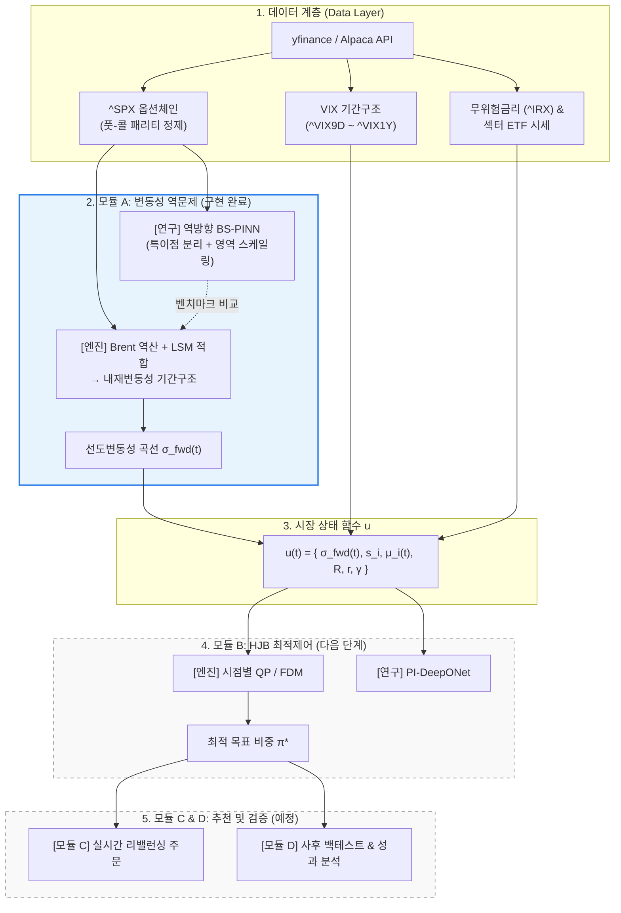

# mfin — 블랙-숄즈 · HJB 기반 포트폴리오 추천 시스템

[](https://www.python.org/)
[](https://pytorch.org/)
[](#-진행-현황-및-로드맵)
[](#-관련-문서)

> **2026-2 수학탐구 프로젝트**  
> 금융수학(블랙-숄즈 PDE, Merton HJB 최적제어)과 인공지능(PINN)을 결합한 S&P 500 동적 자산배분 시스템  
> 
> - **연구자**: 이진혁 (수학과 3학년) | **지도교수**: 황형주 교수님  
> - **관련 문서**: [구현방안.md](구현방안.md) (전체 설계 상세) · [설계대안.md](설계대안.md) (설계 대안 및 채택 근거)

---

## 📌 목차
1. [프로젝트 개요](#-프로젝트-개요)
2. [전체 시스템 아키텍처](#-전체-시스템-아키텍처)
3. [진행 현황 및 로드맵](#-진행-현황-및-로드맵)
4. [설치 및 개발 환경](#-설치-및-개발-환경)
5. [폴더 및 파일 구조](#-폴더-및-파일-구조)
6. [실행 가이드](#-실행-가이드)
   - [테스트 실행](#1-테스트-실행)
   - [모듈 A 실험 (표·그래프 생성)](#2-모듈-a-실험-표그래프-생성)
   - [옵션 데이터 수집 및 자동화](#3-옵션-데이터-수집-및-자동화)
7. [모듈 A 핵심 수학적 설계 (보고서 요약)](#-모듈-a-핵심-수학적-설계-보고서-요약)
8. [알려진 제약 및 엔지니어링 고려사항](#-알려진-제약-및-엔지니어링-고려사항)

---

## 💡 프로젝트 개요

`mfin`은 시장의 파생상품 가격으로부터 내재된 위험(변동성 기간구조)을 역산하고, 이를 거시적 제약 조건 하에서 **HJB(Hamilton-Jacobi-Bellman) 확률제어 방정식**을 통해 최적의 포트폴리오 비중으로 변환하는 엔드투엔드 퀀트 자산배분 시스템입니다.

### 2-Track 설계 철학
- **운용 엔진 (Production Engine)**: 검증된 수치해석/해석해(Brent 역산, FDM, 볼록 최적화 QP)로 안정적인 추천을 도출합니다.
- **연구 비교 모듈 (Research Modules)**: 물리 정보 신경망(**PINN**) 및 연산자 학습(**DeepONet**)을 같은 문제에 적용하여 정확도, 속도, 고차원 확장성을 정량 비교합니다.

---

## 🏗 전체 시스템 아키텍처



---

## 📈 진행 현황 및 로드맵

| 단계 | 모듈 | 내용 | 상태 | 비고 |
| :--- | :--- | :--- | :---: | :--- |
| **Step 1** | **데이터 계층** | 옵션체인 정제, VIX 기간구조, 캐시 시스템 | ✅ 완료 | yfinance 캐싱 및 장애 방어 |
| **Step 1** | **모듈 A (변동성)** | 블랙-숄즈 역문제 (해석해 적합 vs 역방향 PINN) | ✅ 완료 | 특이점 분리(Bachelier) 적용 |
| **Step 2** | **모듈 B (HJB 최적제어)** | Merton 모형 확장, QP 엔진 vs PI-DeepONet 비교 | ⏳ 예정 | 선도변동성 $\sigma_{\text{fwd}}(t)$ 연계 |
| **Step 3** | **모듈 C (추천 엔진)** | Alpaca Paper API 연동 및 일중 슬리피지/마찰비용 제어 | ⏳ 예정 | 모의 투자 연동 |
| **Step 4** | **모듈 D (백테스트)** | 2020~2026 역사적 데이터 기반 벤치마크 대비 성과 평가 | ⏳ 예정 | MDD, Sharpe ratio 분석 |

---

## 💻 설치 및 개발 환경

프로젝트 루트의 가상환경(`.venv`)이 기본 제공됩니다. 새로운 환경을 구성할 경우 아래 단계에 따라 설치합니다.

> [!NOTE]
> PyTorch는 CPU 전용 빌드로 설치하여 패키지 용량과 종속성 충돌을 최소화했습니다.

```powershell
# 1. 가상환경 생성
python -m venv .venv

# 2. PyTorch (CPU 전용) 설치
.\.venv\Scripts\python.exe -m pip install torch --index-url https://download.pytorch.org/whl/cpu

# 3. 개발용 의존성 및 mfin 패키지 editable 설치
.\.venv\Scripts\python.exe -m pip install -e ".[dev]"
```

*이후 모든 Python 명령은 가상환경 인터프리터(`.\.venv\Scripts\python.exe`, 이하 `python`)로 실행합니다.*

---

## 📁 폴더 및 파일 구조

```
project/
├── src/mfin/                     # 핵심 소스코드 패키지
│   ├── data/                     # [데이터 계층] 시세 수집, 전처리, 캐싱
│   │   ├── cache.py              #   - parquet 로컬 캐시 및 지수 백오프 재시도
│   │   ├── loaders.py            #   - 주가, 무위험금리(^IRX → 연속복리 r) 로더
│   │   ├── vix_term.py           #   - VIX 기간구조 수집 (9일, 30일, 3개월, 6개월, 1년)
│   │   ├── option_chain.py       #   - SPX 체인 수집, 풋-콜 패리티(F, D 추정), OTM 환산
│   │   └── snapshot_collector.py #   - 일일 옵션체인 스냅샷 수집 스크립트
│   ├── engine/                   # [운용 엔진] 전통적 금융수학 수치 알고리즘
│   │   ├── bs_analytic.py        #   - Black-76 / 블랙-숄즈 해석해 및 Greeks 계산
│   │   ├── implied_vol.py        #   - Brent 역산 내재변동성, 상수 σ 최소제곱 적합
│   │   └── vol_term.py           #   - ATM 변동성 기간구조, 국소 선도변동성 곡선 σ_fwd(t)
│   ├── pinn/                     # [연구 모듈] 물리 정보 신경망 (PINN)
│   │   ├── core.py               #   - MLP 아키텍처, Autograd 미분, Adam → L-BFGS 최적화
│   │   └── bs_inverse.py         #   - 블랙-숄즈 역방향 PINN (특이점 분리 기법 탑재)
│   └── experiments/              # [실험 및 시각화]
│       ├── module_a.py           #   - 합성/실데이터 벤치마크 실험 및 표/그래프 생성
│       └── module_a_robustness.py #  - 잡음·smile에 대한 PINN 편향 진단 및 손실 가중치 실험
├── tests/                        # 단위 및 통합 테스트 (pytest)
├── data_cache/                   # 다운로드 캐시 및 일일 스냅샷 (gitignore 대상)
├── results/                      # 실험 결과 표(.tex, .csv) 및 차트(.png)
├── 구현방안.md                   # 전체 아키텍처 및 구현 세부 계획서
└── 설계대안.md                   # 방법론 비교 및 의사결정 근거 보고서
```

---

## 🚀 실행 가이드

### 1. 테스트 실행
Pytest 마커(`slow`, `network`)를 통해 필요한 범위의 테스트를 선택 실행합니다.

```powershell
# 1) 빠른 단위 테스트 (기본 권장, 약 3초)
python -m pytest

# 2) PINN 신경망 학습 검증 (합성 데이터 대상, CPU 기준 약 3분)
python -m pytest -m slow

# 3) 실시간 금융 API 연동 스모크 테스트 (네트워크 필요)
python -m pytest -m network
```

---

### 2. 모듈 A 실험 (표·그래프 생성)
실험 스크립트를 실행하면 `results/module_a/` 디렉터리에 비교 표와 시각화 차트가 자동으로 생성됩니다.

```powershell
# [실험 1] 합성 데이터 (Ground Truth 대비 PINN vs 엔진 정확도 비교, 약 15분)
python -m mfin.experiments.module_a --synthetic

# [실험 2] S&P 500 실시장 데이터 (약 10~15분)
python -m mfin.experiments.module_a --live

# [빠른 확인용] 실데이터 학습 epoch 축소 버전 (약 5분)
python -m mfin.experiments.module_a --live --fast
```

---

### 3. 옵션 데이터 수집 및 자동화

#### 1회 수동 수집
현재 시점의 SPX 옵션체인 전 종목을 다운로드하여 정제 후 스냅샷으로 보관합니다.
```powershell
python -m mfin.data.snapshot_collector
# 결과: data_cache/snapshots/SPX_YYYYMMDD.parquet
```

#### Windows 작업 스케줄러 자동 등록
미국 정규장 **마감 30분 전(15:30 ET)**, 한국 시간 기준 **화~토요일 새벽 05:30**에 자동으로 스냅샷을 수집하도록 Windows 작업 스케줄러에 등록할 수 있습니다.

> [!IMPORTANT]
> 반드시 **장중**에 수집해야 합니다. 장이 끝나면 Yahoo가 호가(bid/ask)를 지워 마지막 체결가만 남고, 이 가격은 종목마다 체결 시각이 달라 내재변동성이 왜곡됩니다.
> 미국 서머타임 기간(3월 둘째 일요일~11월 첫째 일요일, 다음 시작일 2027-03-14)에는 같은 15:30 ET가 한국 시간 **04:30**이므로 `/ST 04:30`으로 다시 등록하세요.

> [!TIP]
> PC가 켜져 있고 로그인된 상태에서 정해진 시간에 자동 실행됩니다.

- **스케줄러 등록**:
  ```powershell
  schtasks /Create /TN "mfin_spx_snapshot" /SC WEEKLY /D TUE,WED,THU,FRI,SAT /ST 05:30 /TR "\"C:\Users\wlsgu\Documents\3학년 2학기\수학탐구\project\.venv\Scripts\python.exe\" -m mfin.data.snapshot_collector"
  ```
- **스케줄러 삭제**:
  ```powershell
  schtasks /Delete /TN "mfin_spx_snapshot" /F
  ```

---

## 🔬 모듈 A 핵심 수학적 설계 (보고서 요약)

본 프로젝트는 전통적인 캘리브레이션 방식(Brent 역산)과 현대 딥러닝 기반 역문제 해결(Inverse PINN)을 유기적으로 비교·연계하도록 정밀하게 설계되었습니다.

### 1. 무차원 좌표 변환 (Dimensionless PDE)
블랙-숄즈 방정식을 선도가격 $F$와 행사가격 $K$에 대해 무차원화하여 금리 $r$와 배당수익률 $q$를 선도가격 $F$에 완전히 흡수시킵니다.
- **좌표 정의**: $x = \frac{F}{K}$, $\quad v(\tau, x) = \frac{e^{r\tau} V(\tau, K)}{K}$
- **단순화된 PDE**:
  $$v_\tau = \frac{1}{2} \sigma^2 x^2 v_{xx}$$
- **시장 데이터 전처리**: 각 만기별로 풋-콜 패리티(Put-Call Parity) 회귀분석 $C - P = D(F - K)$을 수행하여 할인계수 $D = e^{-r\tau}$와 무편향 선도가격 $F$를 시장 데이터로부터 직접 추정합니다.

---

### 2. 특이점 분리 기법 (Singularity Separation via Bachelier Base)
- **문제점**: 만기 시점 payoff $\max(x-1, 0)$의 $x=1$ 지점에서 나타나는 꺾임(불연속 1계 도함수)은 매끄러운 활성화 함수($\tanh$)를 사용하는 신경망으로 근사하기 어렵습니다. 이를 소프트 페널티로 강제하면 $\sigma$가 약 22% 과소추정되는 현상이 발생합니다.
- **해결책**: 초기조건을 완벽히 만족하는 해석적 기저해(Bachelier 가격 $\Phi$)를 분리하고, 신경망 $N_\theta$은 부드러운 잔차 보정분만 학습하도록 분해합니다.
  $$v(\tau, x; \sigma) = \Phi(\tau, x; \sigma) + \text{scale} \cdot s \cdot N_\theta(s, x) \quad \left(s = \sqrt{\tau}\right)$$
  - $\tau=0$ ($s=0$)일 때 $v(0, x) = \Phi(0, x) = \max(x-1, 0)$이 항등적으로 성립하여 **초기조건 오차가 0으로 보장**됩니다.

---

### 3. 확산 길이 적응형 영역 스케일링 (Adaptive Domain Scaling)
- 고정된 공간 영역 $[0, 3]$을 사용할 경우, 단기 만기($T=0.1$)에서 옵션 가격 변화 구간이 극단적으로 좁아져 콜로케이션 포인트가 낭비되고 수렴이 저하됩니다.
- 본 구현에서는 확산 길이에 비례하도록 만기별 계산 영역을 동적으로 설정합니다.
  $$x \in \left[ \max(0.1,\, 1 - 6\sigma_0\sqrt{T}),\; 1 + 6\sigma_0\sqrt{T} \right]$$

---

### 4. 선도변동성 곡선 도출 및 HJB 연계
- 각 만기별 내재변동성 $\sigma(T)$로부터 총분산 $w(T) = T \sigma^2(T)$을 계산하고, 캘린더 차익거래가 없도록 단조 증가성($w' \ge 0$)을 보정한 뒤 구간별 기울기로부터 순간 선도변동성 곡선 $\sigma_{\text{fwd}}(t)$를 추출합니다.
- 추출된 곡선은 HJB 최적제어 모듈(모듈 B)의 입력 벡터 $u(t)$로 전달되어 시점별 최적 자산배분 비중을 결정합니다.

---

### 5. 손실 가중치: PDE 우선 ($w_{\text{data}} = 0.1$)
- **문제점**: 실데이터(2026-11-06 SPX)에서 PINN의 $\sigma$가 같은 시세에 대한 해석식 최소제곱 $\sigma$보다 최대 3.6 vol pt 높게 나왔습니다. 합성 실험으로 원인을 분리한 결과, 잡음보다는 **smile**이 주원인이었습니다(smile만 넣어도 +0.6 ~ +2.8 vol pt). 상수 $\sigma$ 모형으로 설명할 수 없는 skew를 신경망이 만기 근처에서 PDE를 어기며 맞추느라 $\sigma$가 위로 치우친 것입니다.
- **해결책**: 데이터 가중치를 PDE 가중치보다 작게 둡니다($w_{\text{pde}} = 1,\ w_{\text{data}} = 0.1$). 그러면 PINN은 "블랙-숄즈 해 중에서 데이터에 가장 가까운 해"를 찾게 되어, 잡음+smile 시나리오에서 제약 최소제곱과 0.1 vol pt 이내로 일치합니다.
- **재현**: `python -m mfin.experiments.module_a_robustness --phase diagnose` / `--phase weights` → `results/module_a/robustness/` (자세한 표는 설계대안.md D14)

---

## ⚠️ 알려진 제약 및 엔지니어링 고려사항

| 범주 | 항목 | 내용 및 처리 방안 |
| :--- | :--- | :--- |
| **데이터 API** | `yfinance` 비공식성 | 스크래핑 차단 대비 `data_cache/` 영구 캐시 계층 및 Exponential Backoff 재시도 로직 구현 |
| **호가 정제** | 장외 호가 스프레드 | Bid/Ask가 0인 비유동성 시간대에는 3영업일 이내 최신 체결가(`last`)를 대체 사용 (`price_source="last"`) |
| **만기 결제** | AM / PM 결제 혼재 | 동일 만기에 SPX(오전 결제)와 SPXW(오후 결제)가 공존하는 경우 유동성(종목 수)이 풍부한 체인을 자동 선택 |
| **Smile 왜곡** | 상수 $\sigma$ 모형의 한계 | 블랙-숄즈 모형은 Volatility Smile을 설명할 수 없으므로, ATM 근방 $\lvert\ln(K/F)\rvert \le \text{clip}(0.5\sigma_{\text{ATM}}\sqrt{T}, 0.02, 0.1)$ 옵션만 엄선하여 적합 |
| **VIX 특성** | 스왑 변동성 괴리 | VIX는 옵션 포트폴리오(분산스왑) 기반이므로 순수 ATM 블랙-숄즈 변동성과 차이가 존재 (백테스트 대리변수로만 활용) |
| **하드웨어** | CPU 연산 환경 | GPU 없이 CPU로 L-BFGS를 훈련하므로 만기 1개당 약 2~4분의 계산 시간이 소요됨 |

---

## 📚 관련 문서
- [구현방안.md](구현방안.md): 세부 수식 유도, 클래스 다이어그램, 10~13주차 주차별 개발 마일스톤
- [설계대안.md](설계대안.md): Dupire 국소변동성 제외 이유, FDM+QP를 기준 엔진으로 채택한 근거
